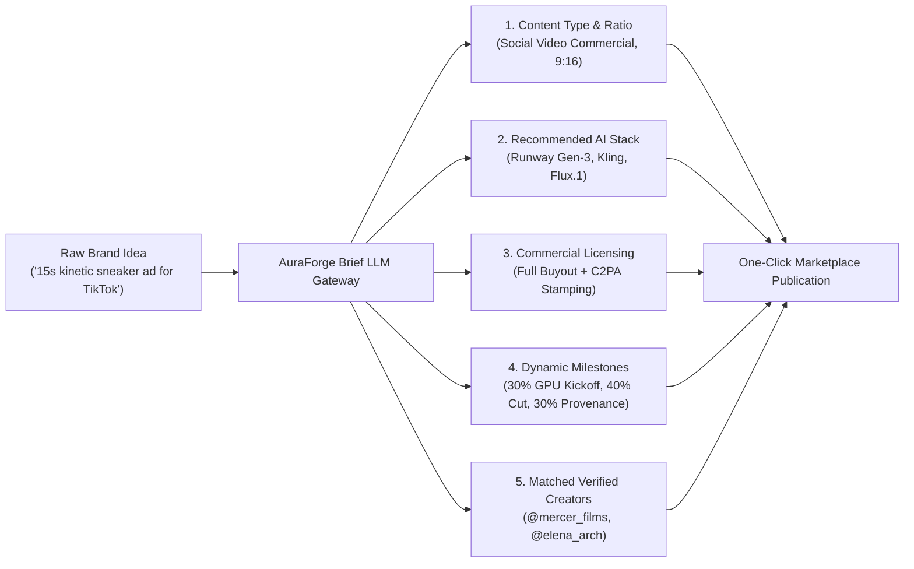

# ⚡ AuraForge • Architecture & Data Model Specification
### AI-Native Content Creator Marketplace
*Built for the AI Content Creator Marketplace Hackathon*

---

## 🎯 Executive Summary

**AuraForge** is an AI-native marketplace architecture connecting generative AI creators (AI filmmakers, 3D animators, virtual avatar creators, and prompt/workflow engineers) with brands and creative agencies. 

Unlike traditional freelance marketplaces (Upwork, Fiverr) that treat deliverables as static attachments, AuraForge integrates:
1. **AI-Native Creator Profiles & Rich Multi-Media Portfolios (30%)** with exact generative toolchains, granular skills, and reproducible ComfyUI DAG workflows.
2. **Brand / Agency Creative Briefs Hub (20%)** capturing content type, visual style, multi-platform aspect ratios, and commercial-use rights.
3. **AI-Assisted Brief Builder (Bonus Credit)** transforming rough unstructured prompts into complete, production-ready creative briefs.
4. **Multi-Attribute Discovery & Search (25%)** with keyword search, multi-filter dropdowns, and sensible empty state handling.
5. **Creator Verification Signals (Bonus Credit)** displaying verified tool certifications, AST-audited workflows, and client track records.
6. **Zero-Leakage Sandbox & Dynamic Compute Escrow (15% UX)** enabling brands to test models before buying while locking milestone payments based on GPU compute tiers.
7. **C2PA Cryptographic Provenance (ISO 21000-22)** embedding tamper-proof authenticity metadata and frequency-domain steganographic watermarks.

---

## 📋 1. Creator Profile & AI Portfolio Data Model

The **Creator Profile** captures the specialized attributes necessary to evaluate generative professionals:

### Data Model Schema (TypeScript Definition)

```typescript
interface CreatorProfile {
  id: string;                                 // Unique creator identifier (e.g. "creator_05")
  name: string;                               // Full name (e.g. "Julian Mercer")
  handle: string;                             // Marketplace handle (e.g. "@mercer_films")
  avatar: string;                             // CDN profile image URL
  specialty: string;                          // Primary discipline (e.g. "AI Filmmaking & Neural VFX")
  bio: string;                                // Background & track record
  rating: number;                             // Client satisfaction rating (e.g. 4.99)
  completed_projects: number;                 // Track record count (e.g. 51)
  verified: boolean;                          // Identity & platform verification flag
  c2pa_certified: boolean;                    // Hardware-backed C2PA certificate status
  compliance_tier: "COMMERCIAL_NON_BRANDED" | "HUMAN_LIKENESS_EDITORIAL";
  hourly_compute_rate: number;                // Base GPU compute rate ($/hr)
  base_model: string;                         // Primary checkpoint (e.g. "Runway Gen-3 Alpha + Luma Ray 2")
  
  // 1. Tool Taxonomy Field
  tools: string[];                            // Specific tools & models utilized:
                                              // e.g. ["Runway Gen-3 Alpha", "ComfyUI", "FLUX.1 Dev", 
                                              //       "Kling AI", "Midjourney v6", "Topaz Video AI"]

  // 2. Skill Taxonomy Field
  skills: string[];                           // Specialized AI-native capabilities:
                                              // e.g. ["Temporal Consistency", "Camera Motion Control", 
                                              //       "LoRA Fine-Tuning", "Neural Lip Sync", "ControlNet"]

  // 3. Content Type Capabilities
  content_types: string[];                    // Deliverable genres:
                                              // e.g. ["AI Short Film", "Social Video Commercial", 
                                              //       "Product Visualization", "Virtual Influencer UGC"]

  // 4. Format / Aspect Ratio Capabilities
  supported_aspect_ratios: string[];          // Multi-placement dimensions:
                                              // e.g. ["16:9 (Cinema)", "9:16 (Vertical Reels/TikTok)", 
                                              //       "1:1 (Square)", "4:5 (Social)", "2.39:1"]

  // 5. Commercial Licensing Terms
  commercial_terms: string[];                 // Licensing tiers:
                                              // e.g. ["Full Buyout & Global Broadcast Rights", 
                                              //       "C2PA v2.1 Chain-of-Custody", "Model Release Included"]

  // 6. Creator Verification Signals (Bonus Credit)
  verification_signals: {
    verified_tools: string[];                 // e.g. ["Runway Certified Director", "ComfyUI Master"]
    verified_workflow: string;                // e.g. "Multi-Pass Seed-Locked Video DAG (SHA-256)"
    past_work: string;                        // e.g. "51 Projects • 4.99 Rating • 100% On-Time"
    trust_badge: string;                      // e.g. "Top Rated Enterprise Creator"
  };

  // 7. Rich Sample Works (AI Portfolios)
  sample_works: PortfolioWork[];

  // 8. Reproducible ComfyUI Execution Pipeline
  default_workflow_json: ComfyUIDAG;
}

interface PortfolioWork {
  id: string;
  title: string;
  type: "video" | "image";
  image_url: string;
  video_url?: string;
  category: string;
  aspect_ratio: string;                       // "16:9", "9:16", "1:1", etc.
  tools_used: string[];                       // Exact tools used in this piece
  prompt: string;                             // Generation prompt excerpt
  c2pa_status: "VERIFIED_AUTHENTIC";
  sha256: string;                             // Deterministic hash of generation output
  watermark_id: string;
}
```

---

## 📑 2. Brand / Agency Creative Brief Data Model

The **Creative Brief** enables brands to specify campaign objectives, model requirements, multi-platform placements, and legal parameters:

### Data Model Schema (TypeScript Definition)

```typescript
interface CreativeBrief {
  id: string;                                 // Brief ID (e.g. "brief_01")
  title: string;                              // Campaign title (e.g. "Cyber-Puma • 15s Sneaker Commercial")
  brand_name: string;                         // Hiring entity (e.g. "Puma Innovation Lab")
  brand_logo: string;                         // Brand avatar URL
  objective: string;                          // Narrative goals, scene beats, and prompt guidance
  
  // 1. Content Type Requirement
  content_type: string;                       // e.g. "Social Video Commercial", "AI Short Film", 
                                              //      "Product Visualization", "3D Character Animation"

  // 2. Visual Style Aesthetic
  style: string;                              // e.g. "Cyber-Futurism, Kinetic Neon, Macro Slow-Mo"

  // 3. Format / Aspect Ratio Requirement
  format_aspect_ratio: string;                // e.g. "9:16 (Vertical Reels/TikTok)", 
                                              //      "16:9 (Cinema / YouTube 4K)", "4:5 (Instagram Feed)"

  // 4. Commercial-Use & Licensing Terms
  commercial_use: string;                     // e.g. "Full Commercial Buyout with C2PA Provenance Manifest",
                                              //      "Worldwide Broadcast License", "Model Likeness Indemnity"

  // 5. Recommended Toolchain & Required Skills
  tools_recommended: string[];                // e.g. ["Runway Gen-3 Alpha", "Kling AI", "Flux.1 Dev"]
  required_skills: string[];                  // e.g. ["Temporal Consistency", "Camera Motion Control"]

  budget_usd: number;                         // Total escrow budget allocation (e.g. 4500.0)
  timeline_days: number;                      // Delivery duration (e.g. 7 days)
  status: "OPEN_FOR_PITCHES" | "IN_PRODUCTION" | "SETTLED";
  matched_creator_ids: string[];              // Auto-matched verified creator IDs

  // 6. Dynamic Milestone Escrow Schedule
  milestones: {
    phase: string;                            // e.g. "LoRA Style & Asset Sandbox Test"
    pct: number;                              // e.g. 30% (Upfront GPU allocation)
    payout: number;                           // e.g. $1350.0 USD
  }[];
}
```

---

## 🤖 3. AI-Assisted Brief Builder Engine (Bonus Feature)

The **AI-Assisted Brief Builder** transforms unstructured, free-form brand concepts into structured production briefs via `/api/briefs/ai-generate`:



---

## 🔍 4. Multi-Attribute Creator Discovery & Search Engine (25%)

The discovery engine filters across 6 simultaneous dimensions with sensible fallback handling via `/api/creators/search`:

| Dimension | Filter Options | Technical Logic |
| :--- | :--- | :--- |
| **Search Query** | Free text | Case-insensitive multi-field substring matching (name, bio, skills, tools, tags) |
| **Tools / Models** | Runway, Flux, ComfyUI, Kling, etc. | Intersected against creator's verified toolchain array |
| **Skills** | Temporal Consistency, Lip Sync, LoRA, etc. | Evaluates specialized technical capabilities |
| **Specialization** | Filmmaking, 3D Animation, Product, etc. | Domain classification |
| **Content Type** | Short Film, Commercial, UGC, Stills | Deliverable medium |
| **Aspect Ratio** | 9:16, 16:9, 1:1, 4:5 | Hardware & composition capability check |
| **Verification** | Verified Only toggle | Filter for platform-verified credentials and trust signals |
| **Empty State Handling** | Sensible Fallback | When 0 creators match all strict criteria, automatically serves closest top-rated verified creators with an informative alert |

---

## 🏆 5. Hackathon Evaluation Criteria Mapping (100 Points + Bonus)

| Criteria | Pts | Hackathon Requirement | AuraForge Implementation |
| :--- | :---: | :--- | :--- |
| **Creator Profiles & AI Portfolios** | **30%** | Rich profiles with videos, tools/models, skills, specialization, and workflows | Interactive creator directory featuring full toolchains, skill tags, video & still portfolio galleries, prompt excerpts, and ComfyUI DAG inspector. |
| **Brief Definition** | **20%** | Capture content type, style, format/aspect ratio, and commercial-use requirements | Complete Brand Briefs Hub with 3-tab architecture (AI Builder, Active Briefs Feed, Manual Form) capturing all 5 dimensions. |
| **Discovery & Filtering** | **25%** | Search & multi-filter by skills, tools, attributes; sensible empty handling | Real-time search bar, 5 categorical dropdown filters, verified-only toggle, active chip dismissals, and top-rated fallback recommendations. |
| **User Experience** | **15%** | Easy flows for creators & brands; clear portfolio viewing | Cyber-luxe dark glassmorphism, responsive modals with video players, one-click sandbox testing, and seamless brief-to-escrow transitions. |
| **Presentation & Demo** | **10%** | Clear prototype demonstration | Live React 19 + FastAPI microservices, interactive Swagger docs, and detailed demo script. |
| **BONUS: Verification Signals** | **+5 Pts** | Trust indicators for tools, workflows, past work | Visible badges on creator cards: Verified Tool Mastery, AST-Audited Workflow DAG, and Client Delivery Track Record. |
| **BONUS: AI Brief Builder** | **+5 Pts** | Transform rough idea into structured brief | Prompt-to-Brief LLM engine parsing free-form concepts into complete structured briefs with auto-matched creators and milestones. |

---

## 🚀 6. How to Run Locally

```bash
# Terminal 1: Backend Gateway (FastAPI)
python -m uvicorn server.main:app --host 127.0.0.1 --port 8000

# Terminal 2: Frontend (Vite + React 19)
npm run dev
```

* **Frontend App**: [http://localhost:5173/](http://localhost:5173/)
* **Backend API Docs**: [http://127.0.0.1:8000/docs](http://127.0.0.1:8000/docs)
