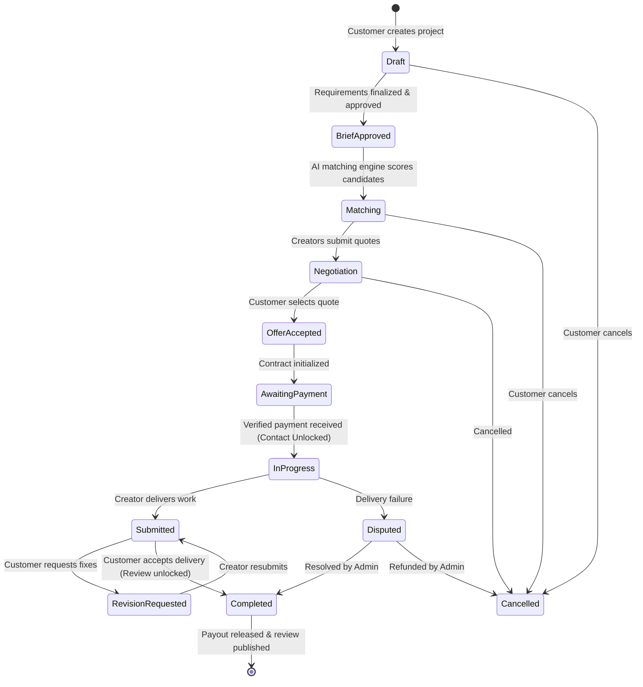

# CreatorSphere AI — Database Architecture & Data Dictionary

## 1. System Overview

**CreatorSphere AI** is an AI-powered marketplace platform bridging customers needing video content with specialized video creators and editors across AI generation, 3D animation, editing, product ads, cinematic films, and social reels.

The database architecture is built on **PostgreSQL 15+** (optimized for **Supabase**), combining relational integrity, secure isolation, real-time messaging, and high-performance querying:
- **Identity & Roles**: Integrated with Supabase Auth (`auth.users`) with automated profile creation and self-escalation protection across 5 roles: `customer`, `creator`, `both`, `moderator`, and `admin`.
- **One-Sided Anonymity**: Creators remain anonymous (pseudonym masking `Creator XXXXXX`) during discovery and quoting. Real identities and private contacts (`creator_private_contacts`) are securely revealed only upon a completed, verified transaction (`contact_unlocks`).
- **AI-Powered Requirement Collection**: Interactive AI brief drafting sessions (`brief_ai_sessions`, `brief_ai_messages`), versioned snapshot revisions (`brief_revisions`), and AI matching scoring (`brief_matches`).
- **In-Platform Moderation & Chat**: Real-time communication (`chat_conversations`, `chat_participants`, `chat_messages`, `chat_attachments`) with automated contact-information censorship, regex/AI logging (`message_moderation_logs`), and appeal workflows.
- **Fair Financial Architecture**: Separation between private creator quotes and customer-facing pricing (`project_quotes`, `customer_quotes_view`), double-entry audit ledger (`financial_ledger`), idempotent payment processing (`payments`), and automated 15% platform fee calculations.
- **Contract Lifecycle Protection**: Formal contract tracking (`projects`) guarded by a strict state-transition trigger preventing illegal status skips or retroactive price tampering.
- **Verified Reviews & Subscriptions**: Tamper-proof rating recalculations tied exclusively to completed contracts (`reviews`), and creator subscription tier management (`creator_subscriptions`).

---

## 2. Entity-Relationship Diagram (ERD)

```mermaid
erDiagram
    users ||--o| creators : "has creator profile (1:1)"
    users ||--o{ briefs : "creates briefs (1:N)"
    users ||--o{ enquiries : "sends direct enquiries (1:N)"
    users ||--o{ brief_ai_sessions : "starts AI sessions (1:N)"
    users ||--o{ chat_participants : "participates in chats (1:N)"
    users ||--o{ projects : "contracts customer (1:N)"
    users ||--o{ payments : "makes payments (1:N)"
    users ||--o{ reviews : "writes customer review (1:N)"

    creators ||--o| creator_private_contacts : "owns private details (1:1)"
    creators ||--o{ portfolio_items : "showcases works (1:N)"
    creators ||--o{ enquiries : "receives enquiries (1:N)"
    creators ||--o{ creator_interests : "submits pitches (1:N)"
    creators ||--o{ verification_signals : "earns signals (1:N)"
    creators ||--o{ brief_matches : "matched to briefs (1:N)"
    creators ||--o{ project_quotes : "submits private quotes (1:N)"
    creators ||--o{ projects : "delivers projects (1:N)"
    creators ||--o{ contact_unlocks : "unlocked by customers (1:N)"
    creators ||--o{ reviews : "receives reviews (1:N)"
    creators ||--o{ creator_subscriptions : "holds subscription (1:N)"

    briefs ||--o{ brief_ai_sessions : "refined through (0:N)"
    briefs ||--o{ brief_revisions : "tracks versions (1:N)"
    briefs ||--o{ brief_matches : "computes matches (1:N)"
    briefs ||--o{ creator_interests : "receives pitches (1:N)"
    briefs ||--o{ project_quotes : "receives formal quotes (1:N)"
    briefs ||--o{ projects : "converts to project (0:1)"
    briefs ||--o{ chat_conversations : "spawns discussions (0:N)"

    chat_conversations ||--o{ chat_participants : "has members (1:N)"
    chat_conversations ||--o{ chat_messages : "contains messages (1:N)"
    chat_messages ||--o{ chat_attachments : "has files (0:N)"
    chat_messages ||--o{ message_moderation_logs : "triggers moderation (0:N)"

    project_quotes ||--o| projects : "binds contract terms (0:1)"
    projects ||--o{ payments : "funded by payments (1:N)"
    projects ||--o| reviews : "produces verified review (0:1)"

    payments ||--o{ financial_ledger : "recorded in ledger (1:N)"
    payments ||--o{ contact_unlocks : "unlocks contact gate (0:N)"
```



---

## 3. Data Dictionary: The 18 Relational Tables

### 3.1 Domain 1: Accounts & Identity
#### `public.users`
Stores user profile information synced automatically from Supabase Auth (`auth.users`).
- `id` (UUID, PK): References `auth.users(id)` ON DELETE CASCADE.
- `email` (TEXT, UNIQUE, NOT NULL): User email address.
- `full_name` (TEXT, NOT NULL): Full display name.
- `role` (TEXT, NOT NULL, DEFAULT `'customer'`): CHECK `role IN ('customer', 'creator', 'both', 'admin', 'moderator')`. Protected against self-escalation by `protect_user_profile` trigger.
- `avatar_url` (TEXT): Profile photo CDN URL.
- `bio` (TEXT): Bio summary.
- `created_at` / `updated_at` (TIMESTAMPTZ, NOT NULL).

#### `public.creators`
Public-facing creator profile details, capabilities, and market signals.
- `id` (UUID, PK): Unique creator UUID.
- `user_id` (UUID, UNIQUE, NOT NULL): References `public.users(id)` ON DELETE CASCADE.
- `handle` (TEXT, UNIQUE, NOT NULL): URL-safe creator username (e.g. `@elena_ai`).
- `display_name` (TEXT, NOT NULL): Public creator display name (masked in `anonymous_creators` view).
- `tagline` (TEXT): Short positioning statement.
- `skills` (TEXT[], NOT NULL, DEFAULT `'{}'`): Array of creative abilities (GIN indexed).
- `tools` (TEXT[], NOT NULL, DEFAULT `'{}'`): Array of hardware/software tools (GIN indexed).
- `styles` (TEXT[], NOT NULL, DEFAULT `'{}'`): Stylistic visual aesthetics.
- `content_types` (TEXT[], NOT NULL, DEFAULT `'{}'`): Supported output categories.
- `equipment` (TEXT[], NOT NULL, DEFAULT `'{}'`): Cameras, GPUs, lighting, and audio equipment (GIN indexed).
- `production_capabilities` (TEXT[], NOT NULL, DEFAULT `'{}'`): In-house studio, 4K HDR, MoCap, etc. (GIN indexed).
- `indicative_budget_min` / `indicative_budget_max` (NUMERIC(10,2), NOT NULL): Minimum and maximum typical project pricing. CHECK `min >= 0 AND max >= min`.
- `currency` (VARCHAR(3), NOT NULL, DEFAULT `'INR'`).
- `availability` (TEXT, NOT NULL, DEFAULT `'available'`): CHECK `availability IN ('available', 'busy', 'unavailable')`.
- `rating` (NUMERIC(3,2), NOT NULL, DEFAULT `0.00`): 0.00 to 5.00. Protected by trigger; updated via verified reviews only.
- `total_reviews` (INT, NOT NULL, DEFAULT `0`): Aggregated review count.
- `is_featured` (BOOLEAN, NOT NULL, DEFAULT `false`): Platform editorial spotlight flag.
- `profile_visibility` (TEXT, NOT NULL, DEFAULT `'public'`): CHECK `profile_visibility IN ('public', 'unlisted', 'private')`.

#### `public.creator_private_contacts`
High-security isolation table holding real-world contact details.
- `creator_id` (UUID, PK): References `public.creators(id)` ON DELETE CASCADE.
- `legal_name` (TEXT): Legal entity or personal legal name for invoicing.
- `contact_email` (TEXT, NOT NULL): Direct private email address.
- `phone_number` (TEXT): Direct phone number.
- `billing_address` (TEXT): Tax/billing address.
- `created_at` / `updated_at` (TIMESTAMPTZ, NOT NULL).

#### `public.contact_unlocks`
Gatekeeper table recording verified unlocking of creator private details.
- `id` (UUID, PK): Unique unlock record.
- `customer_id` (UUID, NOT NULL): References `public.users(id)` ON DELETE CASCADE.
- `creator_id` (UUID, NOT NULL): References `public.creators(id)` ON DELETE CASCADE.
- `project_id` (UUID): Optional formal contract link.
- `payment_id` (UUID): References `public.payments(id)` ON DELETE RESTRICT.
- `unlocked_at` (TIMESTAMPTZ, NOT NULL, DEFAULT `CURRENT_TIMESTAMP`).
- `status` (TEXT, NOT NULL, DEFAULT `'active'`): CHECK `status IN ('active', 'revoked', 'refunded')`.
- `UNIQUE (customer_id, creator_id)`. Protected by trigger `protect_contact_unlock_creation`.

---

### 3.2 Domain 2: Showcase & Quality Proof
#### `public.portfolio_items`
Video portfolio items linked to creator profiles.
- `id` (UUID, PK): Unique item ID.
- `creator_id` (UUID, NOT NULL): References `public.creators(id)` ON DELETE CASCADE.
- `title` (TEXT, NOT NULL): Video title.
- `video_url` (TEXT, NOT NULL): Streaming/embed URL.
- `aspect_ratio` (TEXT, NOT NULL, DEFAULT `'16:9'`): CHECK `aspect_ratio IN ('16:9', '9:16', '1:1', '4:5', '21:9')`.
- `verification_status` (TEXT, NOT NULL, DEFAULT `'unverified'`): CHECK `verification_status IN ('unverified', 'pending', 'verified', 'rejected')`. Protected by `protect_portfolio_verification` trigger.

#### `public.verification_signals`
Independent verification badges and credentials.
- `id` (UUID, PK): Unique signal ID.
- `creator_id` (UUID, NOT NULL): References `public.creators(id)` ON DELETE CASCADE.
- `portfolio_item_id` (UUID): References `public.portfolio_items(id)` ON DELETE CASCADE.
- `signal_type` (TEXT, NOT NULL): e.g. `'identity_verified'`, `'software_certified'`, `'original_footage_verified'`.
- `status` (TEXT, NOT NULL, DEFAULT `'pending'`): CHECK `status IN ('pending', 'verified', 'rejected')`.

---

### 3.3 Domain 3: AI Briefs & Matching
#### `public.briefs`
Customer project requirements.
- `id` (UUID, PK): Unique brief ID.
- `customer_id` (UUID, NOT NULL): References `public.users(id)` ON DELETE CASCADE.
- `title` (TEXT, NOT NULL): Project title.
- `description` (TEXT, NOT NULL): Detailed specifications.
- `ai_summary` (TEXT): Summarized requirements extracted by LLM.
- `budget_min` / `budget_max` (NUMERIC(10,2), NOT NULL): Budget range. CHECK `budget_min >= 0 AND budget_max >= budget_min`.
- `deliverables` (TEXT[], DEFAULT `'{}'`): Specific video exports agreed.
- `required_equipment` (TEXT[], DEFAULT `'{}'`): Hardware requirements.
- `usage_rights` (TEXT, DEFAULT `'commercial'`): Licensing tier.
- `max_revisions` (INT, DEFAULT `2`): Guaranteed revisions limit.
- `status` (TEXT, NOT NULL, DEFAULT `'open'`): CHECK `status IN ('draft', 'open', 'in_review', 'assigned', 'completed', 'cancelled')`. Guarded by `prevent_active_brief_deletion` and `enforce_brief_status_transitions`.
- `approved_at` (TIMESTAMPTZ): Timestamp when customer signed off on requirements.
- `approved_by` (UUID): References `public.users(id)`.

#### `public.brief_ai_sessions`
Interactive conversational sessions between customer and AI assistant to refine briefs.
- `id` (UUID, PK): Session UUID.
- `customer_id` (UUID, NOT NULL): References `public.users(id)` ON DELETE CASCADE.
- `brief_id` (UUID): References `public.briefs(id)` ON DELETE SET NULL.
- `session_title` (TEXT, NOT NULL, DEFAULT `'AI Brief Assistant Session'`).
- `status` (TEXT, NOT NULL, DEFAULT `'active'`): CHECK `status IN ('active', 'completed', 'abandoned')`.

#### `public.brief_ai_messages`
Chat messages within an AI brief session.
- `id` (UUID, PK): Message UUID.
- `session_id` (UUID, NOT NULL): References `public.brief_ai_sessions(id)` ON DELETE CASCADE.
- `sender_role` (TEXT, NOT NULL): CHECK `sender_role IN ('customer', 'assistant', 'system')`.
- `content` (TEXT, NOT NULL): Clarification question or response.
- `clarification_field` (TEXT): The targeted requirement dimension (e.g. `'aspect_ratio'`, `'deliverables'`).
- `model_metadata` (JSONB, DEFAULT `'{}'::jsonb`): Tokens, model version, and reasoning metrics.

#### `public.brief_revisions`
Versioned historical snapshots of generated briefs prior to final sign-off.
- `id` (UUID, PK): Revision UUID.
- `brief_id` (UUID, NOT NULL): References `public.briefs(id)` ON DELETE CASCADE.
- `revision_number` (INT, NOT NULL, CHECK `revision_number >= 1`).
- `snapshot_data` (JSONB, NOT NULL): Complete frozen brief object state.
- `changed_by` (UUID, NOT NULL): References `public.users(id)`.
- `change_summary` (TEXT): Change log description.
- `UNIQUE (brief_id, revision_number)`.

#### `public.brief_matches`
Explainable creator-to-brief matching results computed by ranking algorithms.
- `id` (UUID, PK): Match snapshot UUID.
- `brief_id` (UUID, NOT NULL): References `public.briefs(id)` ON DELETE CASCADE.
- `creator_id` (UUID, NOT NULL): References `public.creators(id)` ON DELETE CASCADE.
- `match_score` (NUMERIC(5,2), NOT NULL, CHECK `0.00 <= match_score <= 100.00`).
- `match_reasons` (JSONB, NOT NULL, DEFAULT `'[]'::jsonb`): Breakdown of score components.
- `is_notified` (BOOLEAN, NOT NULL, DEFAULT `false`).
- `UNIQUE (brief_id, creator_id)`.

---

### 3.4 Domain 4: In-Platform Chat & Moderation
#### `public.chat_conversations`
Threaded discussion channels linked to briefs or active contracts.
- `id` (UUID, PK): Conversation UUID.
- `project_id` (UUID): Optional link to `public.projects(id)`.
- `brief_id` (UUID): References `public.briefs(id)` ON DELETE SET NULL.
- `created_by` (UUID, NOT NULL): References `public.users(id)`.
- `status` (TEXT, NOT NULL, DEFAULT `'active'`): CHECK `status IN ('active', 'archived', 'blocked')`.

#### `public.chat_participants`
Participants in a conversation with anonymous pseudonym masking.
- `id` (UUID, PK): Participant record UUID.
- `conversation_id` (UUID, NOT NULL): References `public.chat_conversations(id)` ON DELETE CASCADE.
- `user_id` (UUID, NOT NULL): References `public.users(id)` ON DELETE CASCADE.
- `role` (TEXT, NOT NULL): CHECK `role IN ('customer', 'creator', 'moderator', 'admin')`.
- `display_alias` (TEXT, NOT NULL): Pseudonym shown in this conversation (e.g. `'Customer Alice'` or `'Creator 000001'`).
- `last_read_at` (TIMESTAMPTZ, NOT NULL, DEFAULT `CURRENT_TIMESTAMP`).
- `UNIQUE (conversation_id, user_id)`.

#### `public.chat_messages`
Messages sent within a conversation.
- `id` (UUID, PK): Message UUID.
- `conversation_id` (UUID, NOT NULL): References `public.chat_conversations(id)` ON DELETE CASCADE.
- `sender_id` (UUID, NOT NULL): References `public.users(id)`.
- `content` (TEXT, NOT NULL): Message body.
- `moderation_status` (TEXT, NOT NULL, DEFAULT `'allowed'`): CHECK `moderation_status IN ('allowed', 'blocked', 'redacted', 'awaiting_moderation', 'approved', 'appeal_submitted', 'appeal_resolved')`. Protected by `protect_chat_message_moderation` trigger.
- `is_edited` (BOOLEAN, NOT NULL, DEFAULT `false`).
- `deleted_at` (TIMESTAMPTZ): Soft-delete timestamp.

#### `public.chat_attachments`
File attachments (storyboards, reference videos, moodboards).
- `id` (UUID, PK): Attachment UUID.
- `message_id` (UUID, NOT NULL): References `public.chat_messages(id)` ON DELETE CASCADE.
- `file_name` (TEXT, NOT NULL): Name of file.
- `file_url` (TEXT, NOT NULL): Storage object key or CDN URL.
- `file_type` (TEXT, NOT NULL): MIME type.
- `file_size_bytes` (BIGINT, NOT NULL, CHECK `file_size_bytes > 0`).
- `is_scanned` (BOOLEAN, NOT NULL, DEFAULT `true`): Malware/anti-virus scan status.

#### `public.message_moderation_logs`
Audit record of prohibited contact information detected in chat.
- `id` (UUID, PK): Log UUID.
- `message_id` (UUID, NOT NULL): References `public.chat_messages(id)` ON DELETE CASCADE.
- `flagged_by` (TEXT, NOT NULL): CHECK `flagged_by IN ('system_regex', 'ai_classifier', 'user_report', 'moderator')`.
- `detection_category` (TEXT, NOT NULL): CHECK `detection_category IN ('phone_number', 'email', 'social_handle', 'external_url', 'direct_solicitation', 'other')`.
- `redacted_snippet` (TEXT): The off-platform contact snippet detected.
- `moderation_decision` (TEXT, NOT NULL): CHECK `moderation_decision IN ('blocked', 'redacted', 'pending_review', 'cleared')`.
- `moderator_id` (UUID): References `public.users(id)`.
- `appeal_note` (TEXT): Sender explanation if appealed.
- `appeal_status` (TEXT): CHECK `appeal_status IN ('pending', 'approved', 'rejected')`.

---

### 3.5 Domain 5: Quotes, Contracts & Financials
#### `public.project_quotes`
Formal proposals submitted by creators with automated fee computation.
- `id` (UUID, PK): Quote UUID.
- `brief_id` (UUID, NOT NULL): References `public.briefs(id)` ON DELETE CASCADE.
- `creator_id` (UUID, NOT NULL): References `public.creators(id)` ON DELETE CASCADE.
- `creator_quote_amount` (NUMERIC(12,2), NOT NULL, CHECK `creator_quote_amount > 0`): Creator's desired net payout.
- `platform_fee_rate` (NUMERIC(5,4), NOT NULL, DEFAULT `0.1500`): Platform take rate (15%).
- `platform_fee_amount` (NUMERIC(12,2), NOT NULL): Automatically calculated fee.
- `tax_amount` (NUMERIC(12,2), NOT NULL, DEFAULT `0.00`): Applicable tax.
- `customer_price_amount` (NUMERIC(12,2), NOT NULL): Total cost to customer. Enforced by trigger `enforce_quote_pricing_integrity`.
- `scope_summary` (TEXT, NOT NULL): Summary of agreed deliverables.
- `deliverables` (TEXT[], NOT NULL, DEFAULT `'{}'`).
- `estimated_delivery_days` (INT, NOT NULL, CHECK `estimated_delivery_days > 0`).
- `revision_count` (INT, NOT NULL, DEFAULT `2`).
- `valid_until` (TIMESTAMPTZ, NOT NULL): Quote expiration time.
- `status` (TEXT, NOT NULL, DEFAULT `'submitted'`): CHECK `status IN ('submitted', 'under_review', 'presented_to_customer', 'accepted', 'declined', 'expired', 'withdrawn')`.
- `UNIQUE (brief_id, creator_id)`.

#### `public.projects`
Binding contract between customer and creator with validated lifecycle state transitions.
- `id` (UUID, PK): Contract project UUID.
- `brief_id` (UUID, NOT NULL): References `public.briefs(id)` ON DELETE RESTRICT.
- `quote_id` (UUID): References `public.project_quotes(id)` ON DELETE RESTRICT.
- `customer_id` (UUID, NOT NULL): References `public.users(id)` ON DELETE RESTRICT.
- `creator_id` (UUID, NOT NULL): References `public.creators(id)` ON DELETE RESTRICT.
- `title` (TEXT, NOT NULL): Project contract title.
- `agreed_amount` (NUMERIC(12,2), NOT NULL, CHECK `agreed_amount > 0`): Total contract value.
- `creator_earnings` (NUMERIC(12,2), NOT NULL, CHECK `creator_earnings > 0`): Net creator share.
- `platform_fee` (NUMERIC(12,2), NOT NULL, CHECK `platform_fee >= 0`): Platform revenue share.
- `currency` (VARCHAR(3), NOT NULL, DEFAULT `'INR'`).
- `status` (TEXT, NOT NULL, DEFAULT `'draft'`): CHECK `status IN ('draft', 'brief_approved', 'matching', 'negotiation', 'offer_accepted', 'awaiting_payment', 'in_progress', 'submitted', 'revision_requested', 'completed', 'cancelled', 'disputed')`. Guarded by `enforce_project_status_transitions` trigger.
- `started_at` / `completed_at` / `cancelled_at` (TIMESTAMPTZ): State transition audit timestamps.

#### `public.payments`
Idempotent payment transaction tracking.
- `id` (UUID, PK): Payment UUID.
- `project_id` (UUID): References `public.projects(id)` ON DELETE RESTRICT.
- `quote_id` (UUID): References `public.project_quotes(id)` ON DELETE RESTRICT.
- `customer_id` (UUID, NOT NULL): References `public.users(id)`.
- `provider` (TEXT, NOT NULL): CHECK `provider IN ('stripe', 'razorpay', 'mock_gateway')`.
- `provider_payment_intent_id` (TEXT, UNIQUE): External gateway transaction ID.
- `amount` (NUMERIC(12,2), NOT NULL, CHECK `amount > 0`).
- `currency` (VARCHAR(3), NOT NULL, DEFAULT `'INR'`).
- `status` (TEXT, NOT NULL, DEFAULT `'pending'`): CHECK `status IN ('pending', 'requires_action', 'succeeded', 'failed', 'refunded', 'disputed')`. Guarded by trigger `protect_payment_state` (only `service_role` can mark succeeded).
- `idempotency_key` (TEXT, UNIQUE, NOT NULL): Ensures exactly-once charge execution.

#### `public.financial_ledger`
Double-entry accounting journal for financial auditability.
- `id` (UUID, PK): Journal entry UUID.
- `payment_id` (UUID, NOT NULL): References `public.payments(id)` ON DELETE RESTRICT.
- `entry_type` (TEXT, NOT NULL): CHECK `entry_type IN ('payment_received', 'platform_fee', 'creator_payout', 'refund', 'dispute_hold')`.
- `account` (TEXT, NOT NULL): CHECK `account IN ('escrow_holding', 'platform_revenue', 'creator_payable')`.
- `amount` (NUMERIC(12,2), NOT NULL, CHECK `amount > 0`).
- `currency` (VARCHAR(3), NOT NULL, DEFAULT `'INR'`).
- `reference_id` (TEXT): Bank transfer ID or refund receipt.

---

### 3.6 Domain 6: Reputation & Subscriptions
#### `public.reviews`
Verified feedback from completed contracts with automated creator rating calculation.
- `id` (UUID, PK): Review UUID.
- `project_id` (UUID, UNIQUE, NOT NULL): References `public.projects(id)` ON DELETE RESTRICT. (Guarantees at most 1 review per project).
- `customer_id` (UUID, NOT NULL): References `public.users(id)` ON DELETE RESTRICT.
- `creator_id` (UUID, NOT NULL): References `public.creators(id)` ON DELETE RESTRICT.
- `rating` (NUMERIC(3,2), NOT NULL, CHECK `1.00 <= rating <= 5.00`).
- `review_text` (TEXT, NOT NULL, CHECK `LENGTH(TRIM(review_text)) >= 10`).
- `moderation_status` (TEXT, NOT NULL, DEFAULT `'published'`): CHECK `moderation_status IN ('published', 'flagged', 'hidden')`.
- Automatically guarded by trigger `validate_and_apply_review`.

#### `public.creator_subscriptions`
Monetization tiers for creators (increased bids, AI tool credits, priority placement).
- `id` (UUID, PK): Subscription UUID.
- `creator_id` (UUID, NOT NULL): References `public.creators(id)` ON DELETE CASCADE.
- `tier` (TEXT, NOT NULL, DEFAULT `'free'`): CHECK `tier IN ('free', 'starter', 'pro', 'agency')`.
- `status` (TEXT, NOT NULL, DEFAULT `'active'`): CHECK `status IN ('active', 'past_due', 'cancelled', 'expired')`. Guarded by `protect_creator_subscription_updates` trigger.
- `provider_subscription_id` (TEXT, UNIQUE): Stripe/Razorpay subscription ID.
- `billing_cycle` (TEXT, NOT NULL, DEFAULT `'monthly'`): CHECK `billing_cycle IN ('monthly', 'yearly')`.
- `current_period_start` / `current_period_end` (TIMESTAMPTZ).
- `cancel_at_period_end` (BOOLEAN, NOT NULL, DEFAULT `false`).

---

## 4. Secure Views

### 4.1 `public.anonymous_creators`
Hides real creator display names until an authorized customer unlocks contact details:
```sql
CREATE OR REPLACE VIEW public.anonymous_creators AS
SELECT 
    c.id,
    c.handle,
    CASE 
        WHEN auth.uid() IS NOT NULL AND public.has_unlocked_creator(auth.uid(), c.id) THEN c.display_name
        ELSE 'Creator ' || UPPER(SUBSTRING(c.id::text, 1, 6))
    END AS display_name,
    c.tagline,
    c.skills,
    c.tools,
    c.styles,
    c.content_types,
    c.equipment,
    c.production_capabilities,
    c.preferred_project_types,
    c.indicative_budget_min,
    c.indicative_budget_max,
    c.currency,
    c.availability,
    c.experience_years,
    c.service_area,
    c.rating,
    c.total_reviews,
    c.is_featured,
    c.profile_visibility
FROM public.creators c
WHERE c.profile_visibility = 'public';
```

### 4.2 `public.customer_quotes_view`
Shields creator raw pricing and fee margins from customer discovery:
```sql
CREATE OR REPLACE VIEW public.customer_quotes_view AS
SELECT 
    pq.id,
    pq.brief_id,
    pq.creator_id,
    pq.customer_price_amount,
    pq.currency,
    pq.scope_summary,
    pq.deliverables,
    pq.estimated_delivery_days,
    pq.revision_count,
    pq.valid_until,
    pq.status,
    pq.created_at
FROM public.project_quotes pq
WHERE pq.status IN ('presented_to_customer', 'accepted');
```

---

## 5. State Transition State Machines


